# Placement Management System

A web-based placement management application that brings students, company recruiters, and administrators together in one platform to organize campus recruitment activities.

## Overview

The system provides separate role-based portals for students, companies, and administrators. It supports job vacancy management, student applications, interview coordination, and placement reporting.

## Features

### Student Portal
- Manage student profile and resume information.
- Browse job opportunities and apply for vacancies.
- Track applications and view interview information.

### Company Portal
- Post and manage job vacancies.
- Review student applications.
- Coordinate interview schedules.

### Admin Portal
- Manage student and company records.
- Oversee jobs, applications, and interviews.
- Review placement statistics and reports.
- Export placement report data.

## Application Screenshots

The following images show the application's main pages. Ensure the corresponding image files are uploaded to the repository's `screenshots/` folder so GitHub can render them here.

### Login Page
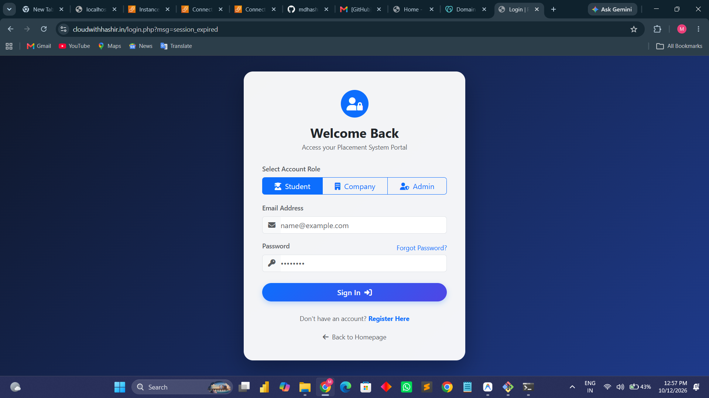

### Student Portal
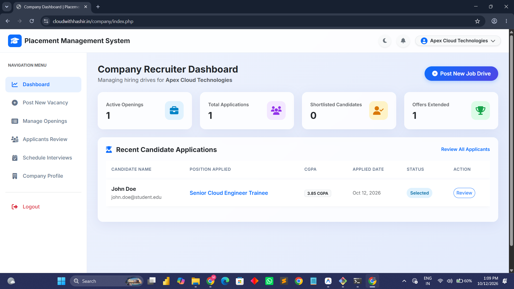

### Company Portal
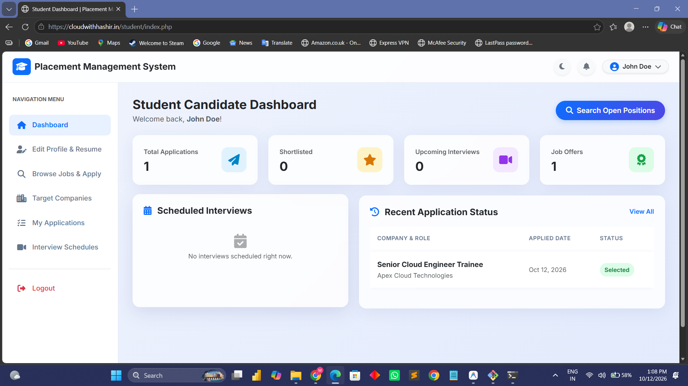

### Admin Portal
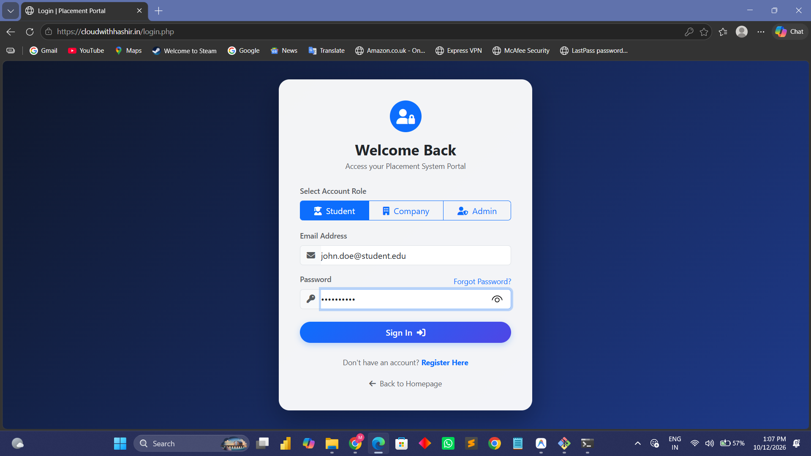

### Additional Application Views

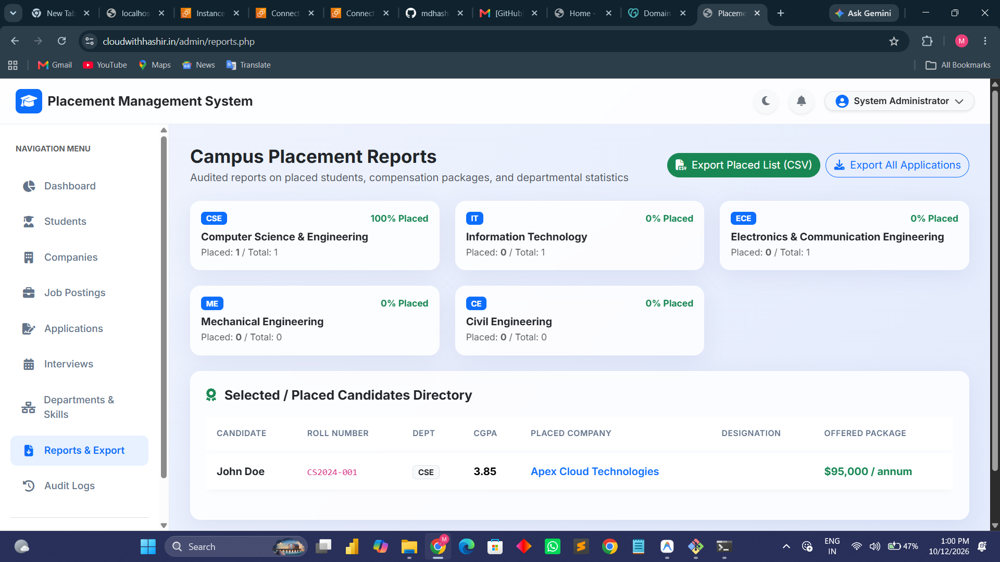

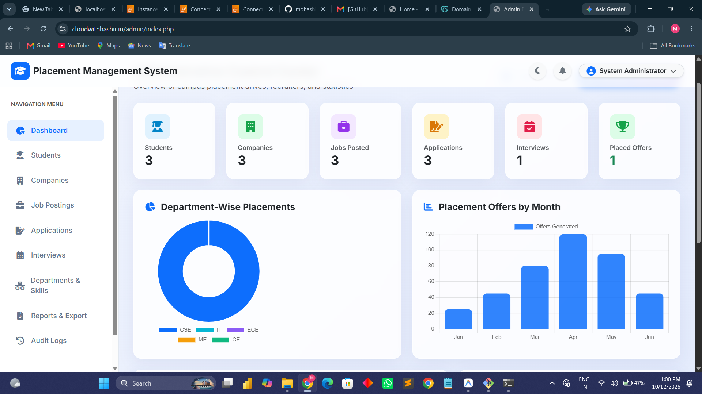

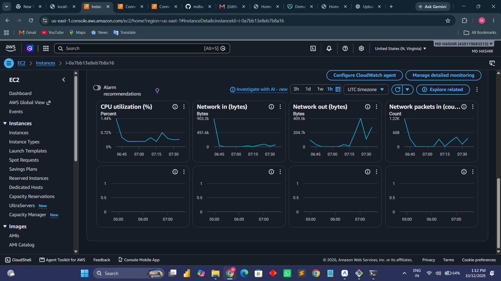

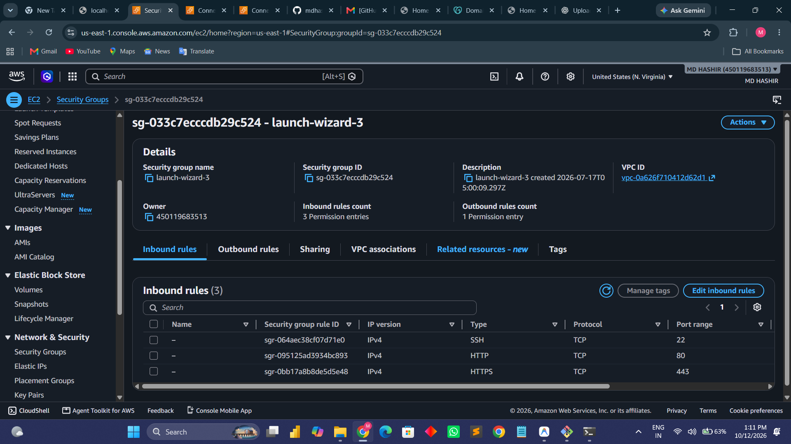

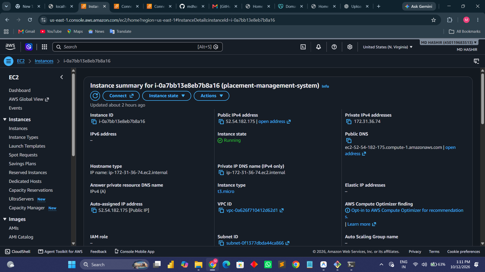

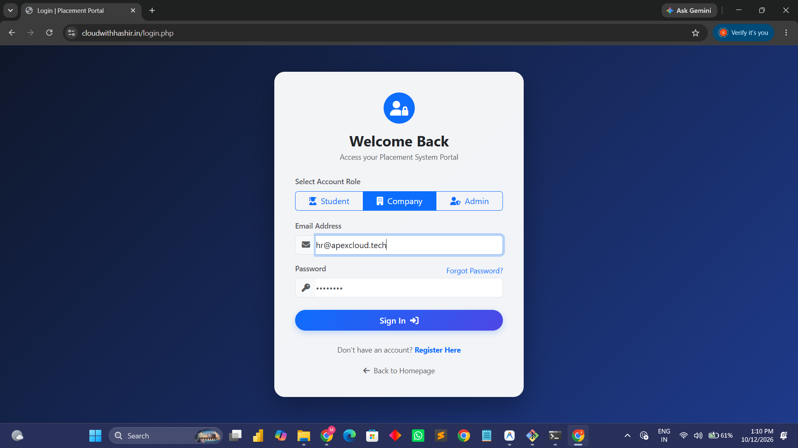

## Domain and DNS Configuration

Amazon Route 53 was used to configure a public hosted zone for the custom domain `cloudwithhashir.in`. The screenshot shows the hosted zone's DNS records, including the A, NS, and SOA records.

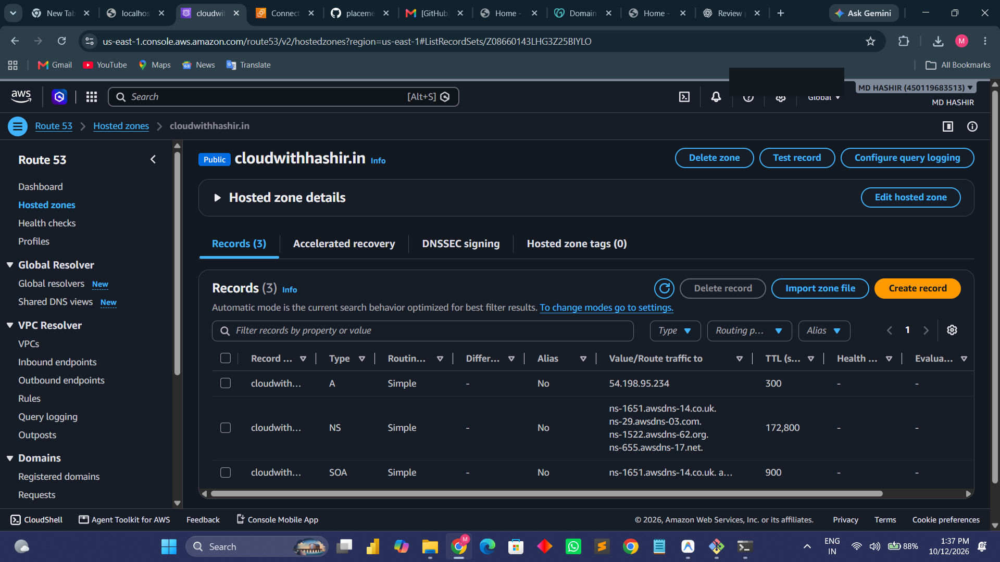

**AWS service:** Amazon Route 53  
**Domain:** `cloudwithhashir.in`  
**Configuration shown:** Public hosted zone with A, NS, and SOA records

*Note: A DNS record screenshot documents configuration, but does not by itself confirm that the website is currently reachable. DNS changes and domain registration/delegation must also be correctly configured.*

## Architecture

The diagram below provides a high-level logical view of the placement management application. Confirm that it matches the actual implementation before presenting it as a deployed cloud architecture.

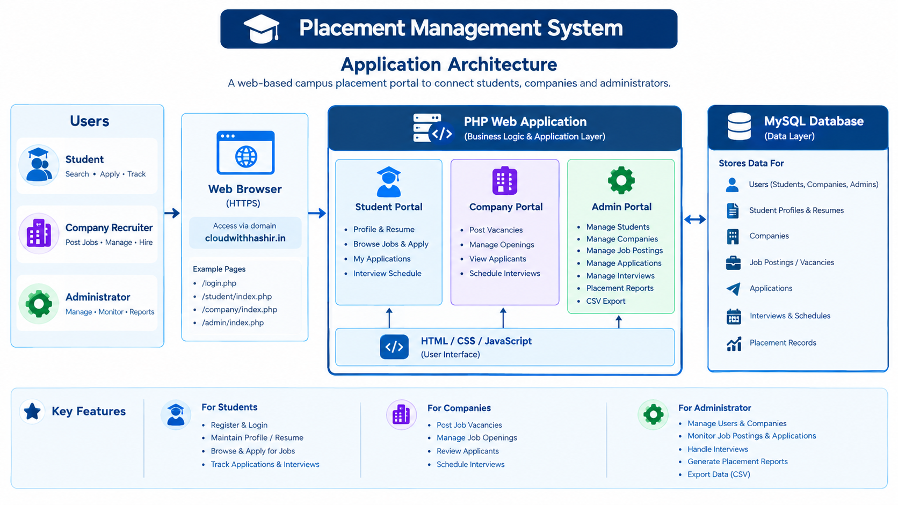

## Technology Stack

The application uses PHP-based page routes. Confirm the source code and database configuration before finalizing the complete technology stack. Include HTML, CSS, JavaScript, PHP, and MySQL only where they match the actual implementation.

## Application Routes

- Login: [https://cloudwithhashir.in/login.php](https://cloudwithhashir.in/login.php)
- Student portal: `/student/index.php`
- Company portal: `/company/index.php`
- Admin portal: `/admin/index.php`
- Admin reports: `/admin/reports.php`

Portal access depends on the user's role and the application's authentication and authorization rules.

## Future Enhancements

- Email notifications for application and interview updates.
- Improved job search and filtering.
- Additional placement analytics.
- Enhanced security monitoring and access controls.
- Responsive improvements for mobile devices.
- Automated deployment workflows, if appropriate for the hosting environment.

## Author

**Mohammed Hashir**

GitHub: [mdhashir05](https://github.com/mdhashir05)
